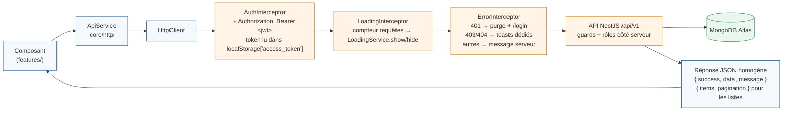
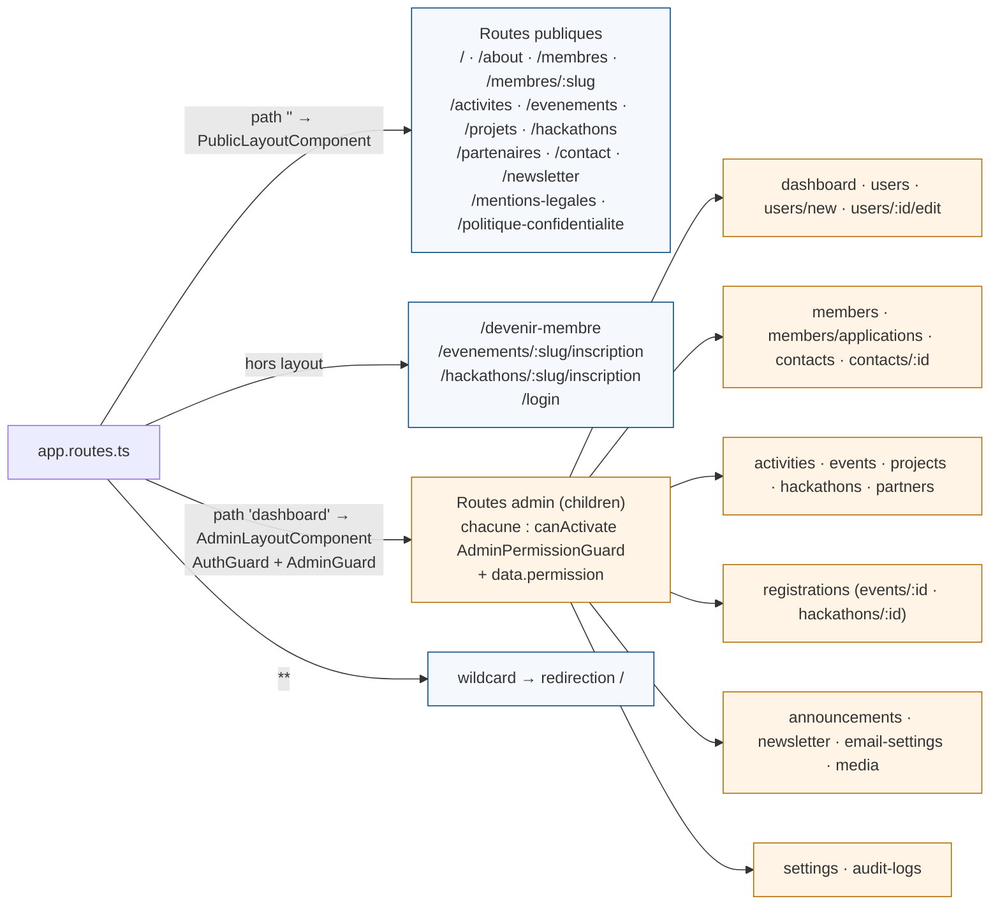

# Architecture générale — Mountains Tech (Mermaid)

Rendu : aperçu GitHub/GitLab, VS Code (extension Markdown Preview Mermaid), ou https://mermaid.live

## 1. Architecture générale

```mermaid
flowchart TB
    %% ===== DÉMARRAGE =====
    subgraph S0["1 · Démarrage — Angular 19 standalone"]
        direction TB
        M0["main.ts<br/>bootstrapApplication(AppComponent, appConfig)"]
        M1["app.config.ts<br/>provideRouter(routes, withViewTransitions)<br/>provideHttpClient(withInterceptorsFromDi)<br/>provideAnimationsAsync<br/>3 × HTTP_INTERCEPTORS : Auth · Loading · Error"]
        M2["app.routes.ts<br/>≈45 routes — lazy loading (loadComponent)"]
        M0 --> M1 --> M2
    end

    %% ===== COQUILLES =====
    subgraph S1["2 · Coquilles de page — layouts/"]
        L1["PublicLayoutComponent<br/>header · main · footer"]
        L2["AdminLayoutComponent<br/>sidebar navigation · top bar · panneau notifications"]
    end

    M2 -->|"routes publiques (path '')"| L1
    M2 -->|"/login — hors layout"| F_AUTH
    M2 -->|"routes /dashboard<br/>canActivate : AuthGuard + AdminGuard"| L2

    %% ===== FEATURES PUBLIQUES =====
    subgraph S2["3 · Site public — features/"]
        direction TB
        F_HOME["home — hero, chiffres clés, projets, événements, membres, hackathon, newsletter"]
        F_ABOUT["about — mission, vision, valeurs, bureau exécutif"]
        F_MEM["members — member-list · member-detail · member-application"]
        F_ACT["activities — activity-list · activity-detail"]
        F_EVT["events — event-list · event-detail · event-registration"]
        F_PRJ["projects — project-list · project-detail"]
        F_HAK["hackathons — hackathon-list · hackathon-detail · team-registration"]
        F_PTN["partners"]
        F_CNT["contact"]
        F_NL["newsletter"]
        F_LEG["legal — mentions-legales · politique-confidentialite"]
    end

    F_AUTH["features/auth — LoginComponent (Reactive Forms)"]

    L1 --> S2

    %% ===== FEATURES ADMIN =====
    subgraph S3["4 · Backoffice — features/admin/ (routes /dashboard)"]
        direction TB
        A_DASH["dashboard — KPI, graphique CSS, activité récente"]
        A_RES["Moteur CRUD générique<br/>resource/admin-resource.base.ts + admin-resource.config.ts<br/>liste · recherche · filtre statut · pagination serveur<br/>modale create/edit · confirmation delete · toasts"]
        A_MEM["members · member-applications · registrations"]
        A_ACT["activities + activity-editor"]
        A_EVT["events + event-editor"]
        A_PRJ["projects"]
        A_HAK["hackathons"]
        A_USR["users + user-create · user-edit"]
        A_ANN["announcements + announcement-editor (WYSIWYG ngx-editor)"]
        A_CNT["contacts + contact-detail"]
        A_MED["media"]
        A_NL["newsletter · email-settings"]
        A_PTN["partners"]
        A_SET["settings"]
        A_AUD["audit-logs"]
        HORS["non routés : sections · tracking · notifications (intégré au layout)"]
        A_RES --> A_MEM & A_ACT & A_EVT & A_PRJ & A_HAK & A_USR & A_CNT & A_MED & A_NL & A_PTN & A_SET & A_AUD
    end

    L2 --> S3

    %% ===== NOYAU =====
    subgraph S4["5 · Noyau transverse — core/"]
        direction TB
        subgraph S4a["core/auth"]
            G["Guards<br/>AuthGuard · AdminGuard · AdminPermissionGuard (data.permission)"]
            I["Interceptors HTTP<br/>Auth (Bearer) · Loading (compteur requêtes) · Error (401/403/404…)"]
            AS["AuthService<br/>login/logout · currentUser$ · hasDashboardAccess() · permissionsForUser()"]
        end
        subgraph S4b["core/http · constants · models"]
            API["http/api.service.ts<br/>get/post/put/patch/delete → environment.apiUrl"]
            RT["constants/api-routes.ts<br/>routes public / admin / auth"]
            MD["models/ — 17 interfaces<br/>ApiResponse · PaginatedResponse · Member · Event · Project · Hackathon · Team · Announcement · User · Contact · Media · Partner · Registration …"]
        end
        subgraph S4c["core/services"]
            NS["NotificationService — toasts (signals)"]
            LS["LoadingService — isLoading$"]
            SD["SiteDataService → /assets/data/site.json"]
            DD["DashboardDataService — forkJoin des endpoints admin"]
        end
    end

    S2 -->|"appels API"| API
    S3 -->|"appels API"| API
    F_AUTH -->|"POST /auth/login"| AS
    AS --> API
    API -->|"1 · AuthInterceptor (JWT)"| I
    I -->|"2 · Loading · 3 · Error"| BE
    I -->|"erreurs 4xx/5xx"| NS
    SD -.->|"données statiques (à brancher sur l'API)"| F_HOME
    DD --> API

    %% ===== PARTAGÉ =====
    subgraph S5["6 · Réutilisables — shared/"]
        SH1["components/ : header · footer · sidebar · top-bar · alert · badge<br/>button · card · pagination · loading-state · loading-spinner · empty-state"]
        SH2["pipes/ : safe-html · date-format · truncate"]
        SH3["directives/ : highlight"]
    end

    S1 -.-> S5
    S2 -.-> S5
    S3 -.-> S5

    %% ===== ENVIRONNEMENTS =====
    subgraph S6["7 · Environnements & assets"]
        ENV["src/environments/<br/>environment.ts (dev) · environment.production.ts<br/>apiUrl · fileReplacements (config production)"]
        AST["src/assets/ · public/<br/>site.json · icons.svg · heroBg.webp · robots.txt · sitemap.xml"]
    end

    ENV -. "apiUrl" .-> API
    AST -.-> S2

    %% ===== EXTERNE =====
    subgraph S7["8 · Systèmes externes"]
        BE["API REST NestJS — /api/v1<br/>auth · members · events · activities · projects · hackathons<br/>announcements · contacts · media · newsletter · settings · audit-logs"]
        DB[("MongoDB Atlas")]
        SMTP["Fournisseur SMTP<br/>envoi des annonces (déclenché backend)"]
    end

    BE --> DB
    BE --> SMTP

    %% ===== STYLES =====
    classDef layer fill:#F5F8FC,stroke:#00447E,color:#12263F
    classDef core fill:#FFF4E5,stroke:#B26A00,color:#3D2500
    classDef ext fill:#EAF7EF,stroke:#1F7A3D,color:#0E3D22
    class S0,S1,S2,S3,S5,S6 layer
    class S4 core
    class S7 ext
```

## 2. Flux d'une requête HTTP (chaîne d'intercepteurs)

## 3. Arborescence des routes (lazy loading + guards)

